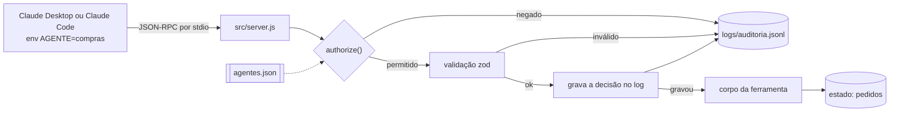

# mcp-obras

Servidor MCP pequeno (Node.js, stdio) em que a permissão de cada agente é aplicada **em código**, não no prompt.

## Problema

Quando um agente de IA tem ferramentas (consultar obras, criar pedido de compra, aprovar pagamento), a regra "o agente de campo não mexe na obra dos outros" costuma morar no prompt. Prompt é pedido, não trava: o modelo pode errar, ser enganado por um texto malicioso que veio num dado, ou simplesmente ignorar a instrução. Quando a ferramenta mexe em dinheiro, a trava precisa ficar onde o modelo não alcança.

## Solução

Um servidor MCP com 6 ferramentas sobre dados **fictícios** de obras, pedidos de compra, cotações e fornecedores. Quem é o agente vem de uma variável de ambiente (`AGENTE`) que quem configura o cliente define, e uma única função, `authorize()`, decide antes de qualquer ferramenta rodar:

- nega por padrão: agente desconhecido, ferramenta fora da lista, tudo é "não";
- cada agente tem uma lista de ferramentas, uma lista de obras e a flag de escrita (`agentes.json`);
- `aprovar_pedido` exige o papel `gestor`, mesmo que alguém liste a ferramenta para outro papel por engano;
- `criar_pedido` nunca vale na hora: o pedido nasce `aguardando_aprovacao` e não entra no orçamento até um gestor aprovar;
- toda chamada de ferramenta que chega ao handler vira uma linha em um log JSONL só de acréscimo (`permitido`, `negado`, `invalido` ou `erro`, este último quando o arquivo de estado está ilegível); se o log não grava, a chamada é recusada;
- argumentos são validados com zod e as respostas têm tamanho máximo.

Esta é uma versão pequena, inspirada em um sistema real de uma construtora. O código foi escrito de novo e nenhum dado de lá foi copiado; a ideia de devolver o resultado das ferramentas como dado, e não como instrução, dentro de um envelope com rótulo aleatório, vem desse sistema.

## Diagrama



Detalhes, sequência de aprovação e códigos de negação em [docs/arquitetura.md](docs/arquitetura.md).

## Stack

Node.js 22+ (declarado em `engines`; testado só em 24.19.0) · `@modelcontextprotocol/sdk` 1.32.2 (stdio) · `zod` 4.6.7 · `node:test` (sem biblioteca de teste).

## Agentes

| Agente | Papel | Escrita | Obras | Ferramentas |
|---|---|---|---|---|
| `compras` | operador | sim | Aurora, Horizonte | listar_obras, resumo_obra, listar_pedidos, buscar_fornecedor, criar_pedido |
| `financeiro` | gestor | sim | Aurora, Horizonte | listar_obras, resumo_obra, listar_pedidos, aprovar_pedido |
| `campo` | operador | sim | só Aurora | listar_obras, resumo_obra, listar_pedidos, buscar_fornecedor, criar_pedido |
| `leitura` | leitor | não | Aurora, Horizonte | listar_obras, resumo_obra, listar_pedidos, buscar_fornecedor |

## Resultado

Números medidos em 28/10/2026 (Windows 10, Node 24.19.0, npm 11.17.0):

- 6 ferramentas, 4 agentes e 5 códigos de negação (tabela em `docs/arquitetura.md`).
- `npm test`: **18 testes, 18 passando** (entre 30 e 50 s num PC com Windows 10; é lento porque 17 dos 18 testes sobem o servidor de verdade como processo filho e falam com ele pelo cliente do SDK; em Linux ou Mac não foi medido).
- Para ver se os testes pegam falha de verdade, desliguei de propósito, numa cópia, a checagem de papel (1 teste falhou) e a de allowlist de obras (2 falharam).
- 366 linhas em `src/` (`wc -l src/*.js`), 327 em `test/`.
- `npm audit` logo após o `npm install`: 0 vulnerabilidades. O SDK está em 1.32.2 porque, nas versões até 1.31.0, `npm audit` aponta 4 avisos (2 de severidade alta e 2 moderada; o resumo do comando conta 1 vulnerabilidade alta), todos de transporte HTTP, OAuth ou tarefas experimentais, que este projeto nem usa; não vale começar com versão que já vem com aviso.

Saída real de `npm run demo`:

```text
leitura    listar_obras    {}                                  -> ok
leitura    criar_pedido    {"obra":"obra-aurora",...           -> NEGADO [FERRAMENTA_NAO_PERMITIDA]
campo      resumo_obra     {"obra":"obra-horizonte"}           -> NEGADO [OBRA_FORA_DO_ESCOPO]
compras    criar_pedido    {"obra":"obra-aurora",...           -> ok
compras    aprovar_pedido  {"pedido_id":"ped-005"}             -> NEGADO [FERRAMENTA_NAO_PERMITIDA]
financeiro aprovar_pedido  {"pedido_id":"ped-005"}             -> ok
fantasma   listar_obras    {}                                  -> NEGADO [AGENTE_DESCONHECIDO]
```

(O script imprime a mensagem de negação completa e depois o log de auditoria; aqui encurtei as colunas.)

Não publico aqui números do sistema real (quantidade de agentes ou ferramentas); este repositório mede só o que está nele.

## Como rodar

Precisa de Node 22 ou mais novo (`engines` do `package.json`; só foi testado no 24.19.0).

```bash
# depois de clonar o repositório
cd mcp-obras
npm install
npm test        # 18 testes (30 a 50 s num PC com Windows 10: 17 deles sobem o servidor)
npm run demo    # passeio de 7 chamadas + o log de auditoria
```

Para usar no Claude Desktop ou no Claude Code (um servidor por agente, cada um com seu `AGENTE`), veja [docs/conectar.md](docs/conectar.md). O servidor não lê `.env`; as variáveis vão no bloco `env` da configuração do cliente:

| Variável | Para quê | Padrão |
|---|---|---|
| `AGENTE` | quem está chamando; precisa existir em `agentes.json` | (vazio: tudo negado) |
| `OBRAS_AGENTES` | caminho do arquivo de agentes | `agentes.json` na raiz do projeto |
| `OBRAS_ESTADO` | onde guardar os pedidos criados | `data/estado.local.json` na raiz do projeto |
| `OBRAS_AUDITORIA` | onde gravar o log | `logs/auditoria.jsonl` na raiz do projeto |

Os padrões valem a partir da raiz do projeto, de qualquer pasta de onde o cliente suba o servidor. Se você definir uma dessas três variáveis, use caminho absoluto: um caminho relativo passa a valer a partir da pasta em que o cliente rodou o comando.

## Estrutura de pastas

```text
mcp-obras/
├── README.md
├── LICENSE               # MIT
├── .gitignore
├── package.json          # e package-lock.json (versões fixas)
├── agentes.json          # quem pode o quê (ferramentas, obras, escrita, papel)
├── data/dados.json       # dados fictícios (obras, fornecedores, pedidos, cotações)
├── src/
│   ├── server.js         # liga tudo: authorize -> validação -> auditoria -> ferramenta
│   ├── authorize.js      # a função que decide, e a validação do agentes.json
│   ├── ferramentas.js    # as 6 ferramentas (schema zod + regra de negócio)
│   ├── auditoria.js      # log JSONL de acréscimo
│   └── estado.js         # leitura e gravação do "banco" (um JSON)
├── test/mcp-obras.test.js
├── scripts/demo.js
└── docs/
    ├── arquitetura.md    # diagramas, decisões, o que falta
    └── conectar.md       # Claude Desktop e Claude Code
```

## Decisões de projeto

- **Nega por padrão.** A função `authorize()` só devolve "pode" se todas as regras passarem. Ferramenta que não existe e ferramenta não liberada recebem a mesma resposta (`FERRAMENTA_NAO_PERMITIDA`); agente desconhecido recebe `AGENTE_DESCONHECIDO`. Nos três casos o resultado é negar.
- **Trava em código, não no prompt.** O prompt (a `description` das ferramentas) ajuda o modelo a se comportar, mas quem impede é o `authorize()`. O teste "mesmo listada por engano, o papel operador continua negado" existe para provar isso.
- **stdio.** É o transporte mais simples, sem porta aberta na rede, e o Claude Desktop e o Claude Code falam com ele. O custo: a identidade é só uma variável de ambiente, sem login.
- **Aprovação em duas camadas.** O pedido só vale depois de `aprovar_pedido`, que é de outro agente com papel `gestor`; além disso, os clientes MCP normalmente pedem confirmação da pessoa antes de rodar uma ferramenta (comportamento do cliente, que não testei aqui; o servidor só marca as de escrita com `readOnlyHint: false`). O servidor não consegue provar que uma pessoa clicou; veja Limitações.
- **`Server` de baixo nível do SDK, não `McpServer`.** Assim nenhuma validação de argumentos nem corpo de ferramenta roda antes do `authorize()` (só a leitura do estado, ver [docs/arquitetura.md](docs/arquitetura.md)), e até chamada com argumentos inválidos cai no log (requisição sem `name` em texto, ou com `arguments` que não é objeto, o SDK recusa antes do handler, e ela fica fora do log). O JSDoc do SDK 1.32.2 marca `Server` como `@deprecated` (recomenda `McpServer`; `Server` só para uso avançado), então o editor pode mostrá-lo riscado. É uma escolha consciente: o `McpServer` valida o schema antes de chamar o callback, e o `authorize()` precisa vir antes.

Mais detalhes e o raciocínio em [docs/arquitetura.md](docs/arquitetura.md).

## Limitações / o que ficou de fora

- **A identidade não é autenticada.** Quem edita a configuração do cliente escolhe o `AGENTE`. Serve para uma máquina de confiança, não para vários usuários.
- **A aprovação humana não é verificável pelo servidor.** Se o `financeiro` for um agente de IA que chama `aprovar_pedido` sozinho, o servidor aprova. Quem garante que há uma pessoa no meio é o pedido de confirmação do cliente MCP, ou, melhor, não expor `aprovar_pedido` a um agente autônomo.
- **"Banco" é um arquivo JSON**, sem trava entre processos: dois agentes gravando ao mesmo tempo, vale o último.
- **O log registra a decisão, não o resultado da execução**, e é de acréscimo por construção do código, não por garantia do sistema de arquivos.
- **Nem toda requisição chega ao log.** Um `tools/call` sem `name` em texto, ou com `arguments` que não é objeto, é recusado pelo SDK (erro JSON-RPC -32603) antes do handler: não passa pelo `authorize()`, nenhuma ferramenta roda e não sai linha em `logs/auditoria.jsonl`. Conferido mandando essas requisições na mão, como em [docs/conectar.md](docs/conectar.md).
- Sem OAuth, sem limite de taxa, sem banco de dados de verdade: o que cada um seria numa versão de produção está em "O que falta" de [docs/arquitetura.md](docs/arquitetura.md).
- Não foi testado dentro do Claude Desktop nem do Claude Code; o `npm test` usa o mesmo comando e as mesmas variáveis de ambiente, pelo cliente do SDK.

## Como foi feito

Rodei `npm test` e `npm run demo` para conferir o resultado.

## Licença

MIT. Veja [LICENSE](LICENSE). Rafael M. da Silva Santos.
