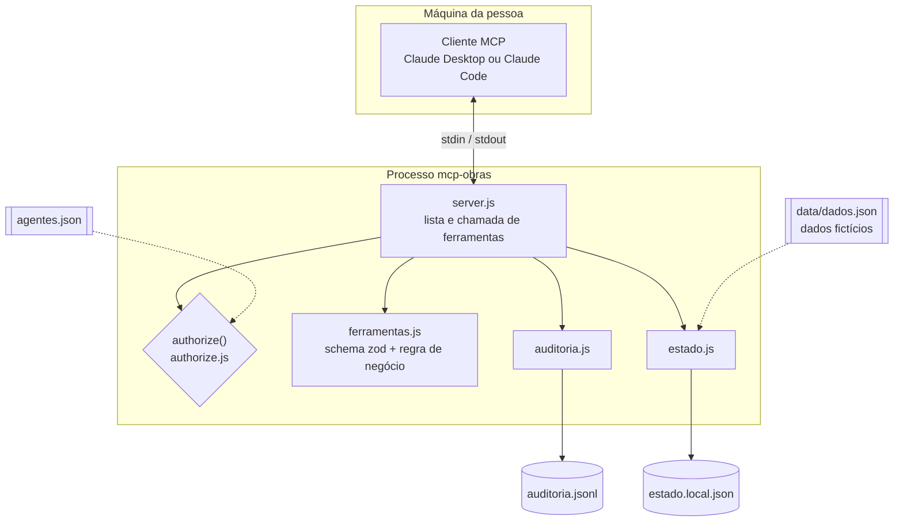
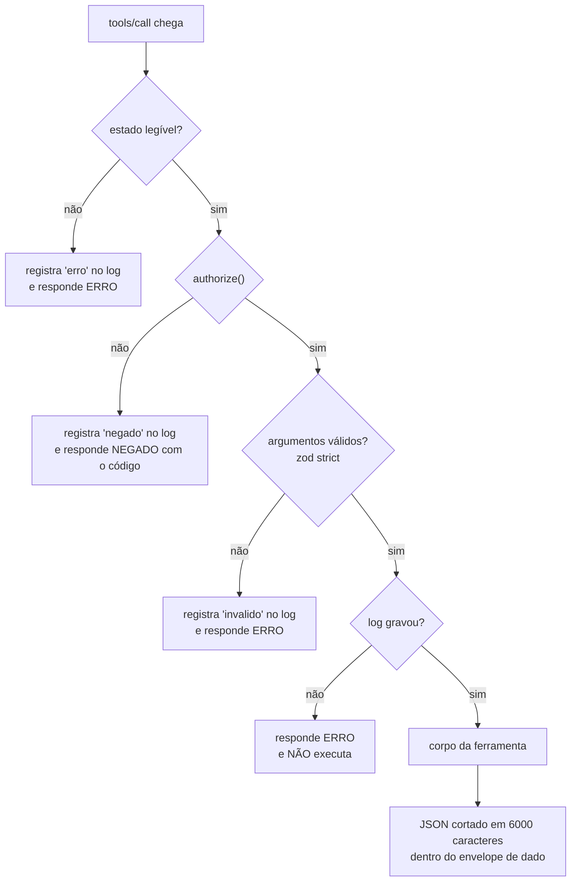
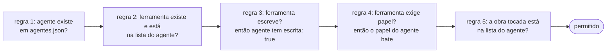
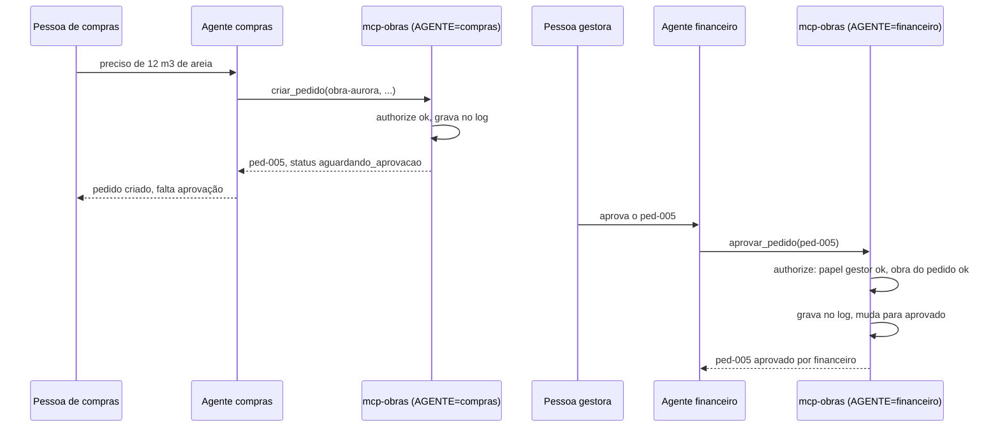

# Arquitetura do mcp-obras

## Visão geral

Um processo por agente. O cliente MCP (Claude Desktop ou Claude Code) sobe `node src/server.js` com `AGENTE=<nome>` no ambiente e conversa com ele por stdin/stdout.

Só o `server.js` importa `estado.js`: ele lê o estado a cada chamada e entrega à ferramenta o objeto `dados` e um `salvar()`. A ferramenta nunca abre o arquivo.

## O caminho de uma chamada

Toda chamada `tools/call` que chega ao handler percorre as mesmas etapas, na mesma ordem. (Requisição sem `name` em texto, ou com `arguments` que não é objeto, o SDK recusa antes, com erro JSON-RPC -32603: não passa pelo `authorize()`, nenhuma ferramenta roda e não sai linha no log.) A ordem importa: a decisão vem primeiro, a validação depois. O estado é lido antes do `authorize()` só porque `aprovar_pedido` precisa dele para achar a obra do pedido; se o arquivo estiver ilegível, a chamada falha, mas ainda deixa uma linha no log.

As regras dentro do `authorize()`, em ordem. A primeira que falhar nega:

| Código | Quando |
|---|---|
| `AGENTE_DESCONHECIDO` | `AGENTE` vazio, ausente ou fora do `agentes.json` (inclui nomes herdados do `Object`, como `constructor`) |
| `FERRAMENTA_NAO_PERMITIDA` | ferramenta fora da lista do agente, ou que nem existe (mesma resposta) |
| `ESCRITA_NAO_PERMITIDA` | ferramenta de escrita, agente com `escrita: false` |
| `PAPEL_INSUFICIENTE` | ferramenta exige papel (`aprovar_pedido` exige `gestor`) e o agente tem outro |
| `OBRA_FORA_DO_ESCOPO` | a obra tocada não está na lista do agente, ou não foi possível saber qual é |

A regra 5 usa uma função `obraDe` que cada ferramenta declara. Em `aprovar_pedido`, a obra **vem do próprio pedido guardado**, não de um argumento que o modelo poderia preencher errado ou de má-fé. E "pedido que não existe" e "pedido de outra obra" respondem exatamente a mesma mensagem, para ninguém conseguir listar o que existe por tentativa e erro.

## Criar e aprovar um pedido

O pedido criado não vale como compra até alguém com papel de gestor aprovar. Antes disso ele aparece em `total_aguardando_aprovacao` do `resumo_obra`, não em `total_aprovado`.

Os dois servidores são processos diferentes e enxergam o mesmo estado porque ele fica em arquivo (`OBRAS_ESTADO`).

## Arquivos

| Arquivo | Papel |
|---|---|
| `agentes.json` | a política: para cada agente, `papel`, `escrita`, `obras` e `ferramentas`. É validado na subida: ferramenta ou obra que não existe derruba o servidor |
| `data/dados.json` | dados fictícios de partida (2 obras, 5 fornecedores, 4 pedidos, 5 cotações) |
| `data/estado.local.json` | estado depois das escritas (criado na primeira escrita, ignorado pelo git) |
| `logs/auditoria.jsonl` | uma linha por chamada: `ts`, `agente`, `ferramenta`, `decisao` (`permitido`, `negado`, `invalido` ou `erro`, este quando o estado está ilegível), `codigo`, `motivo`, `argumentos` |

## Decisões de projeto

**Nega por padrão.** A função `authorize()` começa em "não" e cada regra é um motivo a mais para negar; só chega em "sim" quem passa por todas. Config incompleta ou errada nunca abre acesso: agente sem papel válido ou lista com ferramenta que não existe derruba o servidor na subida. O que não foi previsto é negado.

**Trava em código, não no prompt.** A descrição da ferramenta diz ao modelo o que ela faz e quando usar, e isso melhora o comportamento. Mas o texto chega ao modelo, e o modelo pode errar, ser induzido por texto malicioso que veio num dado (um nome de fornecedor com instrução escondida, por exemplo) ou ignorar. A permissão não depende dele: o `authorize()` roda no servidor, antes do corpo da ferramenta, com a identidade que veio da configuração e não do que o modelo diz. Por isso `AGENTE` está no ambiente do processo e não é argumento de ferramenta. As respostas ainda voltam marcadas como dado, não instrução, com delimitador aleatório por chamada, como segunda barreira para o lado do modelo.

**authorize antes da validação.** Chamada de agente sem permissão não chega nem a testar o formato dos argumentos. Para isso uso o `Server` de baixo nível do SDK com os dois handlers (`tools/list` e `tools/call`) escritos à mão, em vez do `McpServer.registerTool`, que valida o schema antes de chamar o meu código. O custo: escrever na mão o que o `McpServer` dá pronto (algumas dezenas de linhas) e gerar o JSON Schema da lista com `z.toJSONSchema`. O JSDoc do SDK 1.32.2 marca `Server` como `@deprecated` (recomenda `McpServer`; `Server` só para uso avançado), então o editor pode mostrá-lo riscado. É o caso de uso avançado: o `McpServer` valida o schema antes de chamar o callback, e o `authorize()` precisa vir antes.

**Por que stdio.** Um processo por cliente, sem porta aberta na rede, sem sessão para vazar, sem login para implementar; o Claude Desktop e o Claude Code sobem o comando e pronto. A identidade é uma variável de ambiente de um processo que a pessoa mesma configurou. O custo é claro: não serve para o claude.ai no navegador ou no celular, que precisam de um servidor remoto, e a identidade não é autenticada (veja "O que falta").

**Escrita pendente até alguém aprovar.** `criar_pedido` não cria compra, cria um pedido `aguardando_aprovacao`, e o `resumo_obra` só soma o aprovado. A aprovação é outra ferramenta, só do papel `gestor`. Assim, mesmo que o agente de compras seja induzido a criar um pedido absurdo, o estrago é uma linha pendente que uma pessoa vai ler antes de aprovar. Não implementei a regra "quem criou não aprova o próprio pedido": com esta configuração ela não é necessária (quem cria não tem `aprovar_pedido`), mas se alguém der as duas ferramentas ao mesmo agente, passa a ser.

**Auditoria que falha fechada.** O log é gravado **antes** de o corpo da ferramenta rodar; se não grava, a chamada é recusada. Uma ação que muda estado sem deixar rastro é pior do que uma ação que não aconteceu. A contrapartida: o log mostra a decisão (`permitido`), não o desfecho; se o corpo falhar por regra de negócio, o log não diz.

**Mesma resposta para "não existe" e "não é seu".** Evita enumeração: um agente restrito não descobre quais obras ou pedidos existem testando ids.

**Entrada estrita e saída limitada.** O schema zod é `strict` (campo extra é erro), números têm teto, textos têm tamanho máximo e não aceitam caracteres de controle, as listas têm `limite` com máximo e o JSON da resposta é cortado em 6000 caracteres (com o envelope e o aviso, a resposta chega a pouco mais de 6100). Nada devolve o banco inteiro.

**Um JSON como "banco".** É de propósito: o projeto é sobre permissão, não sobre persistência. O código de `estado.js` tem 19 linhas e a troca por um banco de verdade fica isolada ali.

## O que falta

Descrição de alto nível de como uma versão de produção trata cada ponto. Nada disto está implementado neste repositório.

**OAuth e identidade por pessoa.** Hoje a identidade é o `AGENTE` do ambiente, o que só serve numa máquina de confiança. Numa versão de produção o servidor passa a ser remoto (HTTP com streaming, que é o que o claude.ai e o celular falam) e cada requisição chega com um token OAuth 2.1 de uma pessoa ou de um agente com conta própria. O servidor valida o token e a identidade vem dele, não de uma variável. O `authorize()` continua sendo a mesma função, só que recebe a identidade verificada, e a lista do que cada um pode fazer sai das permissões já existentes no sistema da empresa (quem enxerga qual obra), em vez de um `agentes.json` paralelo que teria de ser mantido igual à mão. O SDK oficial tem os pedaços para isso; o que dá trabalho é o fluxo de login e o registro de clientes.

**Banco de dados de verdade.** Um banco relacional com transação no lugar do JSON: a aprovação vira um único `UPDATE ... WHERE status = 'aguardando_aprovacao'`, que é atômico e resolve a corrida entre dois gestores; as regras (status válido, valores positivos, chave estrangeira para obra e fornecedor) viram restrições do banco, não só checagem no código; o log vira uma tabela em que o usuário do servidor só pode inserir (sem `UPDATE` nem `DELETE`), ou vai para um sistema externo de logs, para a imutabilidade deixar de depender de o código se comportar. Também entram: encadeamento de hash nas linhas do log para detectar adulteração, registro do desfecho da execução e a regra de que quem cria não aprova o próprio pedido.

**Limite de taxa.** Um agente em laço (ou induzido por um texto malicioso) pode tentar mil `criar_pedido`. Uma versão de produção conta chamadas por agente em uma janela de tempo e por tipo (escrita com teto bem menor que leitura), tem um teto de pedidos pendentes por agente e por obra, e responde com um código próprio (`LIMITE_EXCEDIDO`) que também vai para o log. O contador pode ficar em memória num processo único e em um armazenamento compartilhado quando houver vários.

**Outros pontos que eu trataria antes de usar com dinheiro de verdade:** a aprovação passar por uma tela ou confirmação de pessoa autenticada, em vez de uma ferramenta que um agente de IA possa chamar sozinho; alertas quando o número de negações de um agente sobe; e revisão periódica de quem tem acesso a quê.
